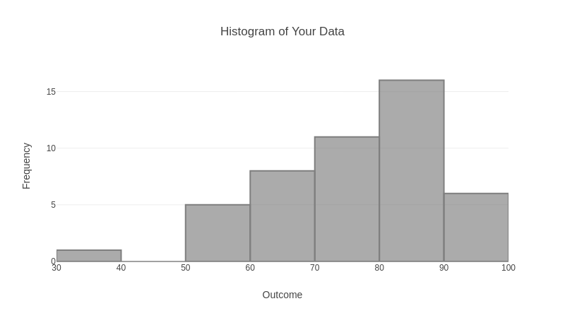
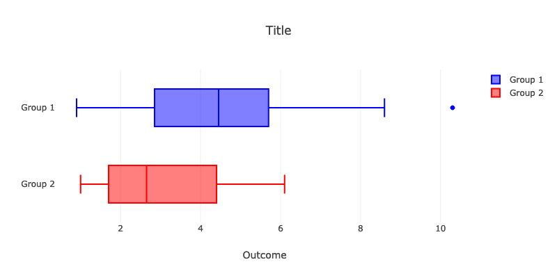
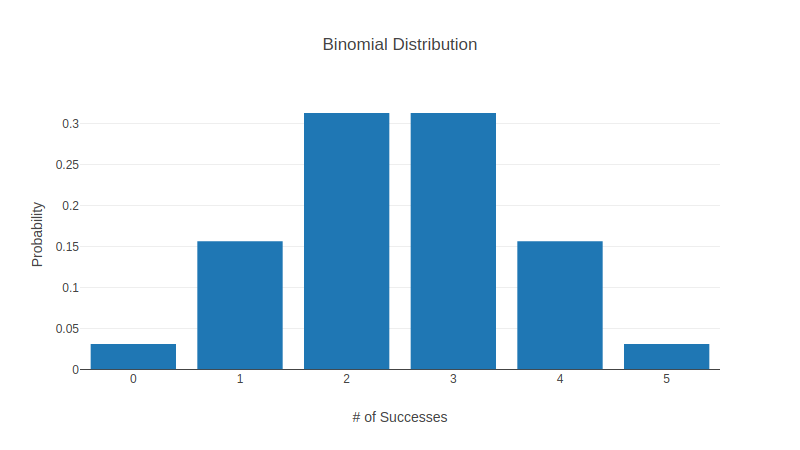
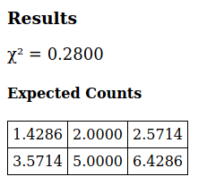
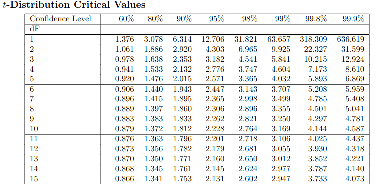

### Boxplots & Histograms

### Side-by-Side Boxplots

### Binomial Distribution

### χ²-Test for Association

### t-Distribution Table

### Other Links

* <a href="https://mabognar.github.io/apps/">Probability Distributions App</a> (<a href="https://play.google.com/store/apps/details?id=com.mbognar.probdist">android</a>, <a href="https://itunes.apple.com/us/app/probability-distributions/id889106396">iOS</a>)
    - <a href="https://mabognar.github.io/apps/normal.html">Normal Distribution</a>
    - <a href="https://mabognar.github.io/apps/t.html">t-Distribution</a>
    - <a href="https://mabognar.github.io/apps/chisq.html">Chi-squared Distribution</a>

 
 
 
 
 
 

